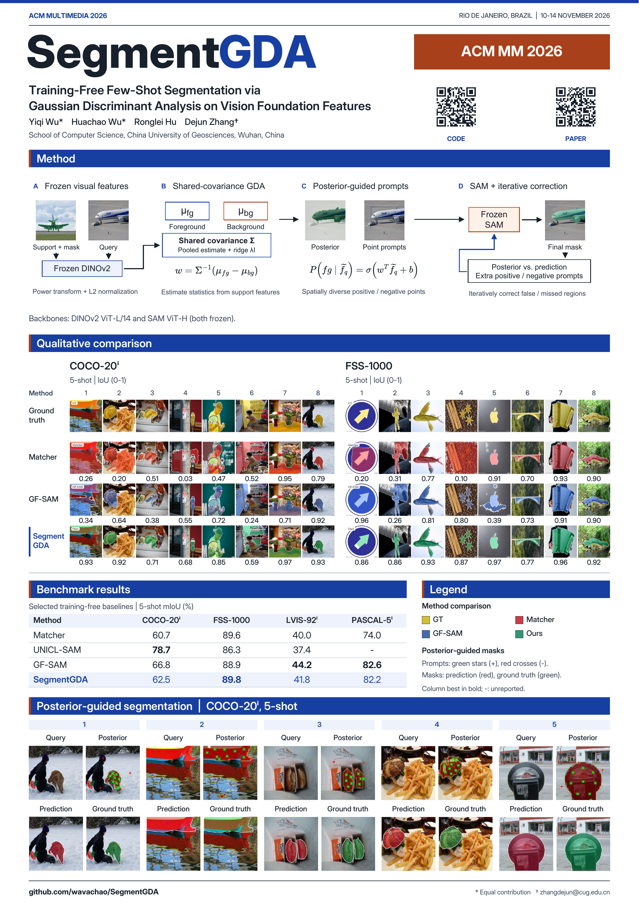

# SegmentGDA Conference Poster

ACM Multimedia 2026 英文海报，A0 竖版（841 × 1189 mm）。

**SegmentGDA: Training-Free Few-Shot Segmentation via Gaussian Discriminant Analysis on Vision Foundation Features**

Yiqi Wu、Huachao Wu、Ronglei Hu、Dejun Zhang · China University of Geosciences, Wuhan

## 当前定稿

- [打印版 PDF](output/final/SegmentGDA_ACMMM2026_A0_final.pdf)
- [可编辑海报 SVG](output/final/SegmentGDA_ACMMM2026_A0_editable.svg)
- [高清 PNG（150 dpi）](output/final/SegmentGDA_high_resolution.png)
- [可编辑方法图（draw.io）](source/final/method.drawio)



本版完整保留论文 Figures 3–5 的 84 个图像单元，并将 48 个逐例 IoU 单独排在图片下方。定量表比较相同 5-shot 设置下的部分训练免费基线；方法图明确共享协方差、sigmoid 后验与迭代提示反馈。

`output/` 根目录及 `source/` 中原有的历版文件均予保留。本次定稿集中在 `output/final/` 和 `source/final/`。

## 重新生成

在仓库根目录执行：

```sh
python -m pip install -r source/final/requirements.txt
python source/final/build_poster.py
```

脚本读取仓库内的论文、流程图和 Inter 字体，生成 `output/final/` 中的 PDF 与可编辑 SVG。运行时无需本机字体或联网下载素材。

预览和高清 PNG 可通过 Poppler 生成：

```sh
pdftoppm -scale-to 3200 -singlefile -png output/final/SegmentGDA_ACMMM2026_A0_final.pdf output/final/SegmentGDA_preview
pdftoppm -r 150 -singlefile -png output/final/SegmentGDA_ACMMM2026_A0_final.pdf output/final/SegmentGDA_high_resolution
```

## 编辑流程图

用 draw.io 打开 `source/final/method.drawio`。修改后，将 PDF 与 SVG 导出到 `source/final/assets/`，再运行海报生成脚本。

```sh
drawio --export --format pdf --crop --output source/final/assets/method.pdf source/final/method.drawio
drawio --export --format svg --embed-images --output source/final/assets/method.svg source/final/method.drawio
```

不同系统的 draw.io 命令名称可能不同。仓库已包含导出的流程图；只修改海报排版时不需要安装 draw.io。

## 来源与字体

- [论文 DOI](https://doi.org/10.1145/3767308.3835710)
- [论文代码](https://github.com/wavachao/SegmentGDA)
- [ACM Multimedia 2026 海报展示指南](https://2026.acmmm.org/site/paper-presenters-guidelines.html)
- [官方打印服务说明](https://2026.acmmm.org/site/poster-printing-service.html)
- Inter 字体许可见 [OFL.txt](source/final/assets/fonts/OFL.txt)。

论文图片与掩膜来自原论文；方法图照片来自作者提供的 draw.io 原图。科研图片的原始掩膜和颜色未改动。
